# Detektor Pesan Penipuan SMS / WhatsApp

Pipeline Machine Learning modular end-to-end untuk mengklasifikasikan pesan SMS/WhatsApp ke dalam tiga kelas (**`0 = normal`**, **`1 = penipuan`**, **`2 = promo`**), lengkap dengan proteksi anti *data leakage*, tuning threshold berbasis risiko penipuan, ekspor metrik lengkap, CLI inferensi lokal, dan deployment bot Telegram.

---

## Arsitektur Pipeline

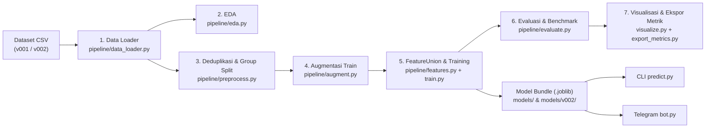

---

## Ringkasan Versi & Dataset

| Versi | Dataset | Total Baris Mentah | Setelah Deduplikasi | Grup Near-Duplicate | Split (`train / val / test`) | Model Terpilih | Threshold | Ukuran Model |
|---|---|---:|---:|---:|---|---|---:|---:|
| **v001** | `dataset_sms_spam_v1.csv` (SMS Indonesia) | 1.143 | 1.135 | 1.081 | `810 / 163 / 162` | `LogReg_C1` (`asli`) | `0.19` | 1,1 MB |
| **v002** | `dataset_sms_spam_v1.csv` + `SpamDam_twitter_data.csv` (multibahasa) | 37.811 | 35.836 | 22.817 | `25.786 / 5.158 / 4.892` | `LogReg_C20` (`asli`) | `0.20` | 10,8 MB |

### Komposisi Split per Kelas (Anti Data Leakage)

| Split | v001 Normal | v001 Penipuan | v001 Promo | **Total v001** | v002 Normal | v002 Penipuan | v002 Promo | **Total v002** |
|---|---:|---:|---:|---:|---:|---:|---:|---:|
| **Train** | 405 | 236 | 169 | **810** | 405 | 25.213 | 168 | **25.786** |
| **Validation** | 81 | 48 | 34 | **163** | 81 | 5.043 | 34 | **5.158** |
| **Test** | 81 | 47 | 34 | **162** | 81 | 4.776 | 35 | **4.892** |

> **Catatan anti-leakage:** Seluruh 154 grup pesan yang menjadi test set **v001** (`162` SMS Indonesia) dikunci agar tidak pernah masuk ke `train` maupun `val` pada **v002**, sehingga evaluasi benchmark **v001 vs v002** 100% adil dan bebas kebocoran data.

---

## Perbandingan Metrik Lengkap (v001 vs v002)

### Tabel Metrik Global & Kelas Penipuan

| Metrik | v001 (`LogReg_C1`, thr `0.19`)<br>Test v001 (`n=162`) | v002 (`LogReg_C20`, thr `0.20`)<br>Test Gabungan (`n=4.892`) | v002 (`LogReg_C20`, thr `0.20`)<br>Benchmark v001 (`n=162`) | v002 (`LogReg_C20`, argmax `0.50`)<br>Benchmark v001 (`n=162`) |
|---|---:|---:|---:|---:|
| **Accuracy** | **96.30%** | **99.20%** | 89.51% | 95.06% |
| **Balanced Accuracy** | **95.53%** | 85.41% | 86.18% | 93.29% |
| **Macro F1** | **95.80%** | 84.38% | 86.69% | 93.74% |
| **Weighted F1** | **96.32%** | **99.22%** | 89.47% | 95.07% |
| **Matthews Corr Coef (MCC)** | **0.9412** | 0.8317 | 0.8433 | 0.9235 |
| **Cohen's Kappa** | **0.9404** | 0.8316 | 0.8314 | 0.9205 |
| **ROC-AUC (OvR Macro)** | **0.9984** | 0.9929 | 0.9919 | 0.9919 |
| **PR-AUC / AP (Macro)** | **0.9971** | 0.8906 | 0.9842 | 0.9842 |
| **Log Loss** | 0.1362 | **0.0297** | 0.2397 | 0.2397 |
| **Brier Score (Penipuan)** | 0.0215 | **0.0077** | 0.0418 | 0.0418 |
| **Recall Penipuan (TPR)** | 97.87% | 99.56% | **100.00%** | **100.00%** |
| **Precision Penipuan (PPV)** | **90.20%** | **99.64%** | 73.44% | 85.45% |
| **Specificity Penipuan (TNR)** | **95.65%** | 85.34% | 85.22% | 93.04% |
| **False Negative Rate (FNR)** | 2.13% | 0.44% | **0.00%** | **0.00%** |
| **False Positive Rate (FPR)** | **4.35%** | 14.66% | 14.78% | 6.96% |
| **F1 Penipuan** | **93.88%** | **99.60%** | 84.68% | 92.16% |
| **F2 Penipuan** | 96.23% | **99.58%** | 93.25% | **96.71%** |
| **Jumlah Kesalahan** | **6 / 162** | 39 / 4.892 | 17 / 162 | 8 / 162 |

### Visualisasi Perbandingan Lintas Versi

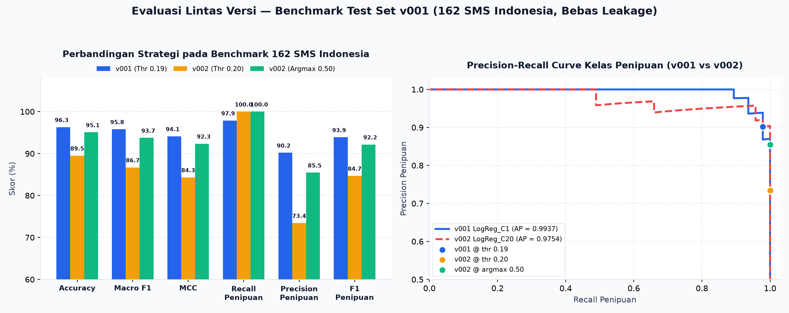

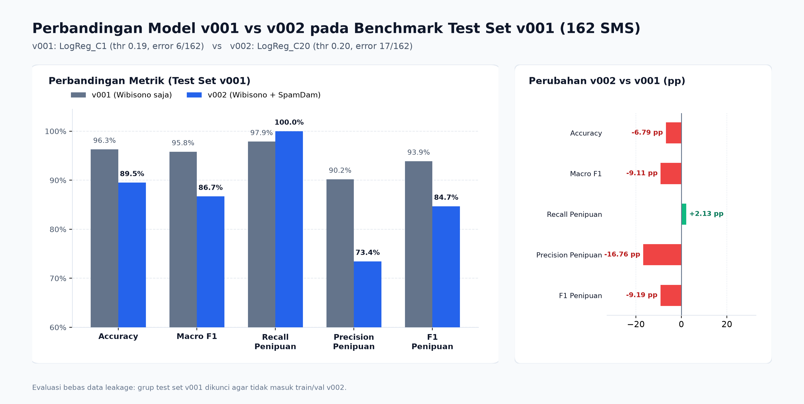

---

## Detail Evaluasi Versi v001 (`dataset_sms_spam_v1.csv`)

### Dashboard Ringkasan v001

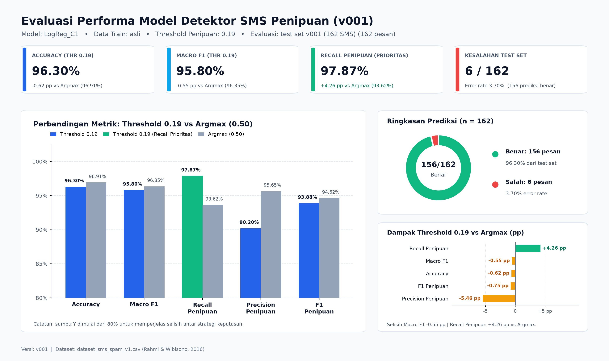

### Metrik per Kelas v001 (Threshold `0.19`, `n = 162`)

| Kelas | Support | TP | FP | FN | Precision | Recall | F1-Score | Specificity | ROC-AUC | PR-AUC (AP) |
|---|---:|---:|---:|---:|---:|---:|---:|---:|---:|---:|
| **normal** | 81 | 79 | 1 | 2 | 98.75% | 97.53% | 98.14% | 98.77% | 0.9983 | 0.9984 |
| **penipuan** | 47 | 46 | 5 | 1 | 90.20% | 97.87% | 93.88% | 95.65% | 0.9972 | 0.9937 |
| **promo** | 34 | 31 | 0 | 3 | 100.00% | 91.18% | 95.38% | 100.00% | 0.9998 | 0.9992 |

### Confusion Matrix v001

| Aktual \ Prediksi | normal | penipuan | promo | Recall (%) |
|---|---:|---:|---:|---:|
| **normal** | 79 | 2 | 0 | 97.53% |
| **penipuan** | 1 | 46 | 0 | 97.87% |
| **promo** | 0 | 3 | 31 | 91.18% |

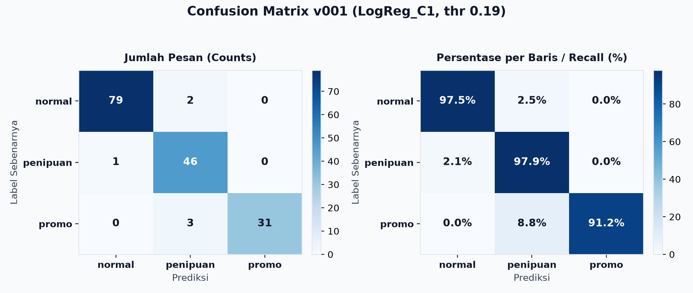
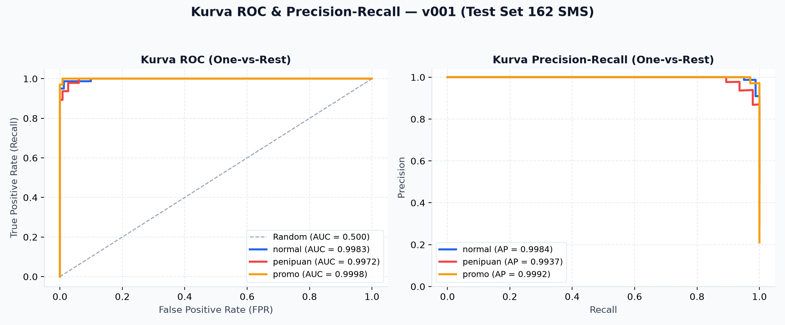
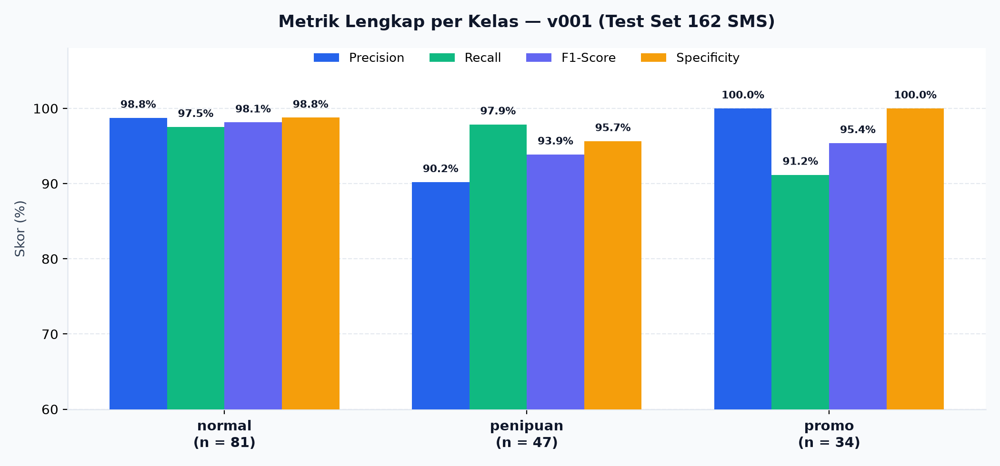
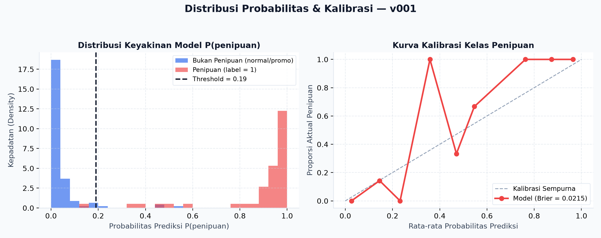

---

## Detail Evaluasi Versi v002 (`dataset_sms_spam_v1.csv` + `SpamDam_twitter_data.csv`)

### Dashboard Ringkasan v002 (Test Gabungan `n = 4.892`)

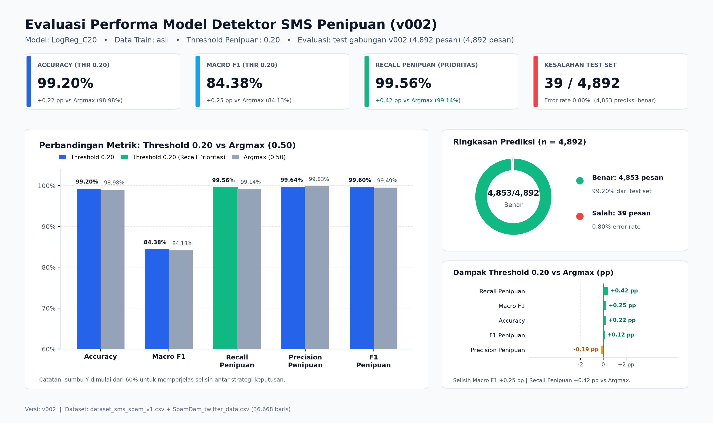

### Metrik per Kelas v002 — Test Gabungan (Threshold `0.20`, `n = 4.892`)

| Kelas | Support | TP | FP | FN | Precision | Recall | F1-Score | Specificity | ROC-AUC | PR-AUC (AP) |
|---|---:|---:|---:|---:|---:|---:|---:|---:|---:|---:|
| **normal** | 81 | 76 | 6 | 5 | 92.68% | 93.83% | 93.25% | 99.88% | 0.9935 | 0.9731 |
| **penipuan** | 4.776 | 4.755 | 17 | 21 | 99.64% | 99.56% | 99.60% | 85.34% | 0.9923 | 0.9998 |
| **promo** | 35 | 22 | 16 | 13 | 57.89% | 62.86% | 60.27% | 99.67% | 0.9928 | 0.6990 |

### Confusion Matrix v002 (Test Gabungan)

| Aktual \ Prediksi | normal | penipuan | promo | Recall (%) |
|---|---:|---:|---:|---:|
| **normal** | 76 | 5 | 0 | 93.83% |
| **penipuan** | 5 | 4.755 | 16 | 99.56% |
| **promo** | 1 | 12 | 22 | 62.86% |

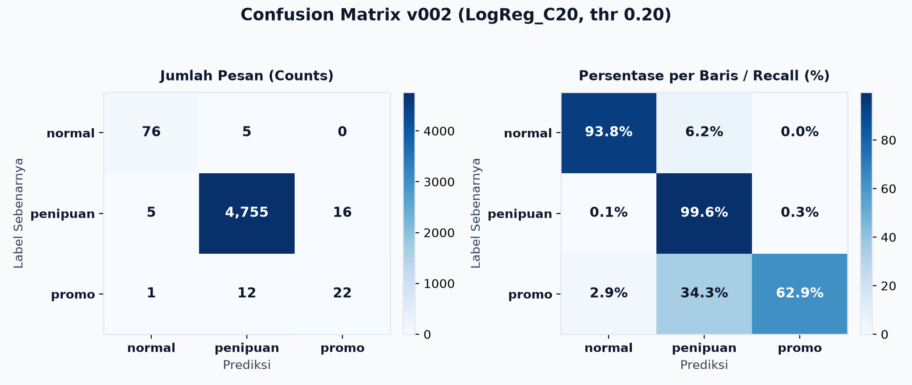
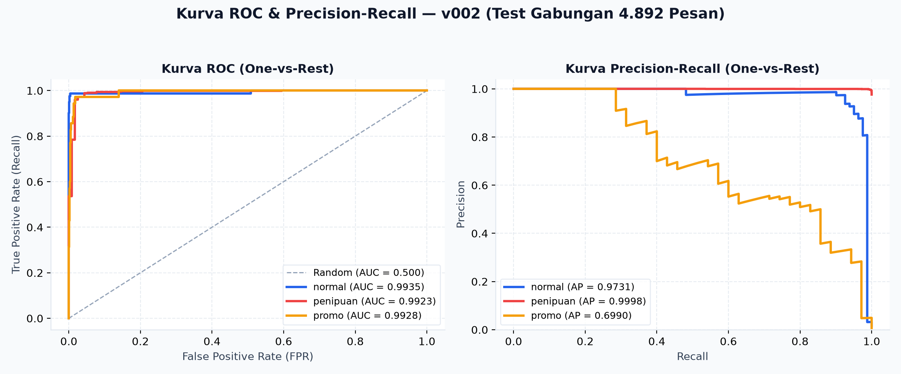
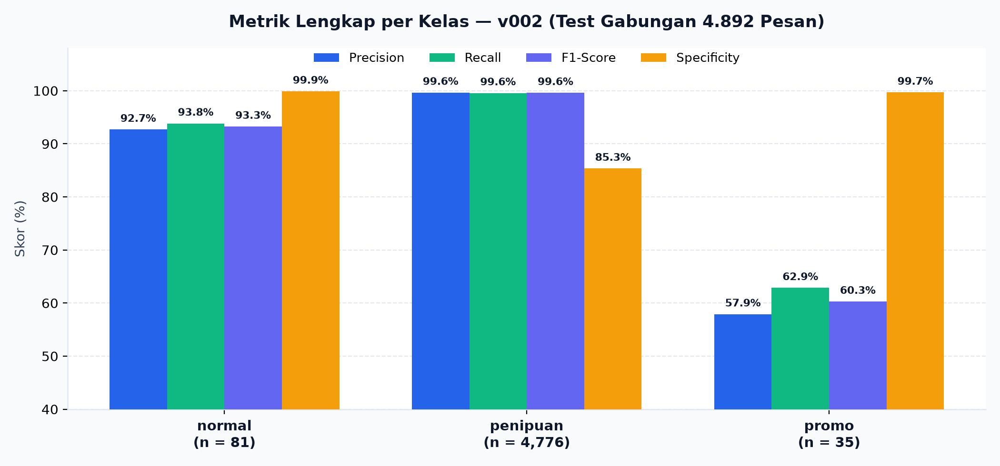
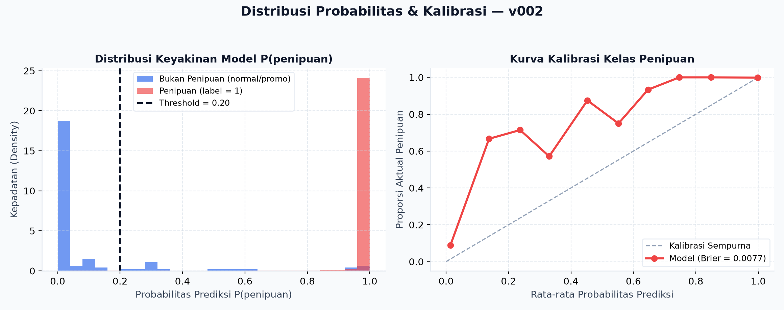

### Benchmark v002 pada Test Set v001 (`162` SMS Indonesia, Bebas Leakage)

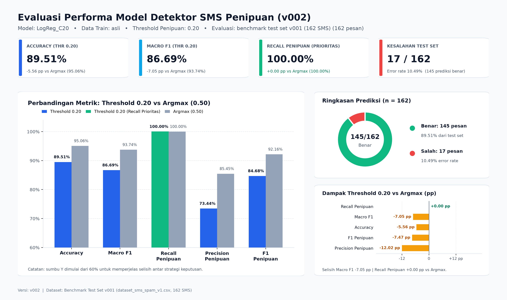
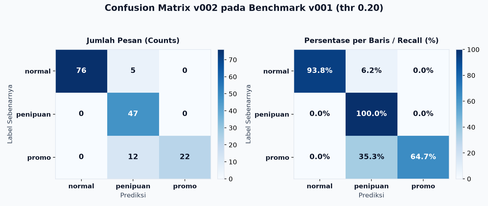

---

## Perbandingan Kandidat Model pada Validation Set

### Top 5 Kandidat — v001 (`val = 163`)

| Model | Data Train | Accuracy | Macro F1 | Recall Penipuan | Precision Penipuan | F1 Penipuan | Waktu (detik) |
|---|---|---:|---:|---:|---:|---:|---:|
| **LogReg_C1** *(terpilih)* | asli | 94.48% | 93.62% | 87.50% | 95.45% | 91.30% | 0.78 |
| LogReg_C1 | asli+augmentasi | 94.48% | 93.62% | 87.50% | 95.45% | 91.30% | 1.10 |
| LinearSVM | asli | 94.48% | 93.11% | 87.50% | 95.45% | 91.30% | 0.55 |
| LogReg_C5 | asli+augmentasi | 94.48% | 93.11% | 87.50% | 95.45% | 91.30% | 1.16 |
| LogReg_C20 | asli+augmentasi | 94.48% | 93.11% | 87.50% | 95.45% | 91.30% | 0.98 |

### Top 5 Kandidat — v002 (`val = 5.158`)

| Model | Data Train | Accuracy | Macro F1 | Recall Penipuan | Precision Penipuan | F1 Penipuan | Waktu (detik) |
|---|---|---:|---:|---:|---:|---:|---:|
| LinearSVM *(tanpa predict_proba)* | asli | 99.17% | 80.83% | 99.70% | 99.47% | 99.58% | 24.14 |
| **LogReg_C20** *(terpilih)* | asli | 98.91% | 80.36% | 99.23% | 99.66% | 99.44% | 32.29 |
| LinearSVM | asli+augmentasi | 99.09% | 80.29% | 99.58% | 99.50% | 99.54% | 26.19 |
| LogReg_C5 | asli | 98.76% | 78.91% | 99.05% | 99.68% | 99.36% | 31.35 |
| LogReg_C20 | asli+augmentasi | 98.82% | 78.37% | 99.19% | 99.62% | 99.40% | 34.02 |

---

## Analisis Singkat dan Rekomendasi Penggunaan

| Skenario Penggunaan | Model yang Direkomendasikan | Pertimbangan Teknis |
|---|---|---|
| **Pesan SMS / WhatsApp Bahasa Indonesia sehari-hari** (meminimalkan *false positive*) | **`v001`** (`LogReg_C1`, threshold `0.19`) | Accuracy **96.30%**, Macro F1 **95.80%**, Precision Penipuan **90.20%**, dan Recall Penipuan **97.87%**, dilengkapi aturan keamanan `.apk`. |
| **Cakupan multibahasa dan deteksi modus `.apk` / phishing internasional** | **`v002`** (`LogReg_C20`, threshold `0.20` atau argmax `0.50`) | Recall Penipuan mencapai **100.00%** pada benchmark Indonesia, mendeteksi pola `.apk` secara alami dari bobot model (`75%`–`96%`), serta mengenali pesan phishing lintas bahasa (Inggris, Spanyol, Prancis, Belanda). |

### Contoh Hasil Pengujian Pesan (Smoke Test — v002)

| Contoh Pesan Uji | Prediksi v002 | Probabilitas (`normal / penipuan / promo`) | Keterangan |
|---|---|---|---|
| `Assalamualaikum, ini undangan pernikahan kami. Mohon dibuka ya: Undangan_Pernikahan.apk` | **PENIPUAN** | `4% / 96% / 0%` | Terdeteksi langsung oleh model (fitur `.apk`) |
| `Paket Anda dari J&T tertahan karena alamat tidak lengkap. Lihat foto resi di sini: Resi_JNT.apk` | **PENIPUAN** | `24% / 75% / 1%` | Terdeteksi langsung oleh model (fitur `.apk`) |
| `SELAMAT! No Anda terpilih mendapat cek tunai Rp175jt dari Shopee. Info klik bit.ly/hadiah-shopee` | **PENIPUAN** | `0% / 100% / 0%` | Pola hadiah + tautan + kapitalisasi |
| `Mah ini aku ganti nomor. Tolong transfer 500rb dulu ke rek BRI ini ya, penting banget` | **PENIPUAN** | `4% / 96% / 0%` | Pola rekayasa sosial + transfer mendesak |
| `Dear Customer your bank account will be suspended, click http://verify-bank.xyz` | **PENIPUAN** | `0% / 100% / 0%` | Pola phishing berbahasa Inggris |
| `Nikmati kuota 30GB cuma Rp50rb! Aktifkan sekarang di *363#` | **PROMO** | `0% / 0% / 99%` | Pola promosi operator + kode USSD |
| `Bro nanti malam jadi futsal jam 8? kabarin ya` | **NORMAL** | `99% / 1% / 0%` | Percakapan sehari-hari |

---

## Struktur Proyek

```text
Deteksi-Penipuan-SMS-ddan-email-berbasis-text/
├── README.md                      # Dokumentasi utama proyek
├── sms_utils.py                   # Utilitas bersama (normalisasi, fitur meta, threshold, penjelasan prediksi)
├── run_pipeline.py                # Orkestrator pipeline end-to-end (--version v001 / v002)
├── predict.py                     # Antarmuka CLI untuk inferensi lokal (teks tunggal, JSON, interaktif)
├── bot.py                         # Layanan bot Telegram detektor pesan penipuan
├── requirements.txt               # Daftar dependensi Python
├── pipeline/
│   ├── config.py                  # Konfigurasi terpusat dan preset versi (v001, v002)
│   ├── data_loader.py             # Tahap 1: pemuatan dan validasi berkas CSV
│   ├── eda.py                     # Tahap 2: Exploratory Data Analysis
│   ├── preprocess.py              # Tahap 3: deduplikasi, pengelompokan near-duplicate, dan pembagian data
│   ├── augment.py                 # Tahap 4: augmentasi kelas minoritas (khusus data latih)
│   ├── features.py                # Tahap 5: FeatureUnion dan definisi kandidat model
│   ├── train.py                   # Tahap 6: pelatihan, perbandingan model, tuning threshold, dan penyimpanan model
│   ├── evaluate.py                # Tahap 7: evaluasi data uji, benchmark v001, interpretasi, dan smoke test
│   ├── visualize.py               # Generator grafik dashboard dan perbandingan antar versi
│   ├── export_metrics.py          # Generator direktori metrics/ lengkap (JSON, CSV, PNG, Markdown)
│   └── indobert.py                # Modul opsional: fine-tuning IndoBERT sebagai pembanding
├── models/
│   ├── sms_scam_model.joblib      # Model tersimpan v001
│   └── v002/sms_scam_model.joblib # Model tersimpan v002
├── outputs/                       # Artefak eksekusi pipeline per versi (splits, plots, reports)
│   ├── plots/, reports/, splits/  # Artefak v001
│   └── v002/                      # Artefak v002
└── metrics/                       # Paket metrik evaluasi lengkap untuk dokumentasi dan laporan
    ├── README.md
    ├── all_metrics_complete.json
    ├── summary_table.csv
    ├── per_class_metrics.csv
    ├── comparison_v001_vs_v002.csv
    ├── v001/                      # Metrik lengkap dan 6 grafik PNG untuk v001
    ├── v002/                      # Metrik lengkap, benchmark_v001, dan 9 grafik PNG untuk v002
    └── comparison/                # Grafik dan JSON perbandingan langsung lintas versi
```

---

## Instalasi & Cara Menjalankan

### 1. Instalasi Dependensi
```powershell
python -m venv .venv
.venv\Scripts\activate
pip install -r requirements.txt
```

### 2. Menjalankan Pipeline Training & Evaluasi
```powershell
# Jalankan versi default (v002: Wibisono + SpamDam Twitter)
python run_pipeline.py

# Jalankan versi v001 (dataset_sms_spam_v1.csv saja)
python run_pipeline.py --version v001

# Opsi tambahan
python run_pipeline.py --version v002 --skip-eda
python run_pipeline.py --version v002 --run-indobert

# Atau jalankan tiap tahap secara terpisah
python -m pipeline.data_loader
python -m pipeline.eda
python -m pipeline.preprocess
python -m pipeline.augment
python -m pipeline.train
python -m pipeline.evaluate
```

### 3. Mengekspor Folder `metrics/` Lengkap
```powershell
python -m pipeline.export_metrics
```

### 4. Uji Prediksi lewat CLI
```powershell
# Default menggunakan v002
python predict.py "SELAMAT! Anda menang cek tunai Rp175jt, klik bit.ly/hadiah"
python predict.py "Dear Customer your bank account will be suspended, click http://verify-bank.xyz"

# Pilih versi v001 atau output JSON / interaktif
python predict.py --version v001 "Bro nanti malam jadi futsal jam 8?"
python predict.py --version v002 --json "Nikmati kuota 30GB cuma Rp50rb di *363#"
python predict.py --interactive
```

### 5. Menjalankan Bot Telegram
```powershell
# Set token dari @BotFather dan pilih versi model (opsional, default: v002)
$env:TELEGRAM_BOT_TOKEN="123456:ABC..."
$env:MODEL_VERSION="v002"
python bot.py
```

---

## Sumber Data & Lisensi

- **Dataset Utama (`dataset_sms_spam_v1.csv`):** Rahmi, F. and Wibisono, Y. (2016). *Aplikasi SMS Spam Filtering pada Android menggunakan Naive Bayes*, Unpublished manuscript. Lisensi: [CC BY-SA 4.0](https://creativecommons.org/licenses/by-sa/4.0/).
- **Dataset Tambahan v002 (`SpamDam_twitter_data.csv`):** SpamDam Twitter SMS Spam Dataset (36.668 pesan spam multibahasa).
