# Laporan Metrik Lengkap — Detektor Pesan Penipuan SMS/WA

Dibuat otomatis pada: `2026-11-21 09:52:37`

Folder ini menghimpun seluruh metrik evaluasi lengkap (global, per-kelas, biner kelas penipuan, probabilistik ROC-AUC / PR-AUC / Log Loss / Brier Score, MCC, Cohen's Kappa, Confusion Matrix, analisis error, dan grafik PNG) untuk **v001** dan **v002**.

---

## 1. Ringkasan Perbandingan Utama

| Metrik | v001 (`LogReg_C1`, thr 0.19) Test v001 (`n=162`) | v002 (`LogReg_C20`, thr 0.20) Test Gabungan (`n=4.892`) | v002 (`LogReg_C20`, thr 0.20) Benchmark v001 (`n=162`) | v002 (`LogReg_C20`, argmax 0.50) Benchmark v001 (`n=162`) |
|---|---:|---:|---:|---:|
| **Accuracy** | 96.30% | 99.20% | 89.51% | 95.06% |
| **Balanced Accuracy** | 95.53% | 85.41% | 86.18% | 93.29% |
| **Macro F1** | 95.80% | 84.38% | 86.69% | 93.74% |
| **Weighted F1** | 96.32% | 99.22% | 89.47% | 95.07% |
| **Matthews Corr Coef (MCC)** | 0.9412 | 0.8317 | 0.8433 | 0.9235 |
| **Cohen's Kappa** | 0.9404 | 0.8316 | 0.8314 | 0.9205 |
| **ROC-AUC (OvR Macro)** | 0.9984 | 0.9929 | 0.9919 | 0.9919 |
| **PR-AUC / AP (Macro)** | 0.9971 | 0.8906 | 0.9842 | 0.9842 |
| **Log Loss** | 0.1362 | 0.0297 | 0.2397 | 0.2397 |
| **Brier Score (Penipuan)** | 0.0215 | 0.0077 | 0.0418 | 0.0418 |
| **Recall Penipuan (TPR)** | 97.87% | 99.56% | 100.00% | 100.00% |
| **Precision Penipuan (PPV)** | 90.20% | 99.64% | 73.44% | 85.45% |
| **Specificity Penipuan (TNR)** | 95.65% | 85.34% | 85.22% | 93.04% |
| **False Negative Rate (FNR Penipuan)** | 2.13% | 0.44% | 0.00% | 0.00% |
| **False Positive Rate (FPR Penipuan)** | 4.35% | 14.66% | 14.78% | 6.96% |
| **F1 Penipuan** | 93.88% | 99.60% | 84.68% | 92.16% |
| **F2 Penipuan** | 96.23% | 99.58% | 93.25% | 96.71% |
| **Jumlah Error** | 6 / 162 | 39 / 4892 | 17 / 162 | 8 / 162 |

### Grafik Perbandingan Lintas Versi

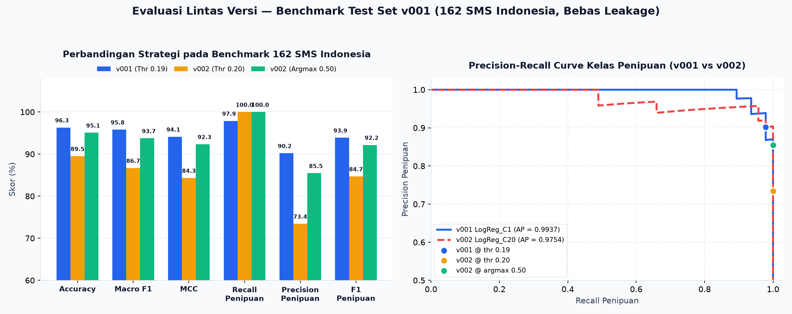
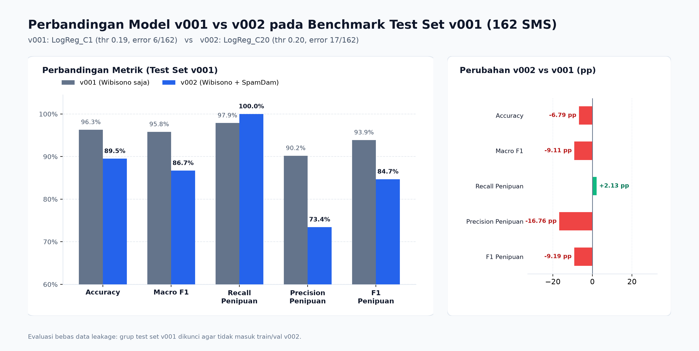

---

## 2. Detail v001 (`dataset_sms_spam_v1.csv`, `n = 162`)

### Metrik per Kelas (v001)
| Kelas | Support | TP | FP | FN | Precision | Recall | F1-Score | Specificity | ROC-AUC | PR-AUC (AP) |
|---|---:|---:|---:|---:|---:|---:|---:|---:|---:|---:|
| **normal** | 81 | 79 | 1 | 2 | 98.75% | 97.53% | 98.14% | 98.77% | 0.9983 | 0.9984 |
| **penipuan** | 47 | 46 | 5 | 1 | 90.20% | 97.87% | 93.88% | 95.65% | 0.9972 | 0.9937 |
| **promo** | 34 | 31 | 0 | 3 | 100.00% | 91.18% | 95.38% | 100.00% | 0.9998 | 0.9992 |

### Confusion Matrix (v001)
| Aktual \ Prediksi | normal | penipuan | promo | Recall (%) |
|---|---:|---:|---:|---:|
| **normal** | 79 | 2 | 0 | 97.53% |
| **penipuan** | 1 | 46 | 0 | 97.87% |
| **promo** | 0 | 3 | 31 | 91.18% |

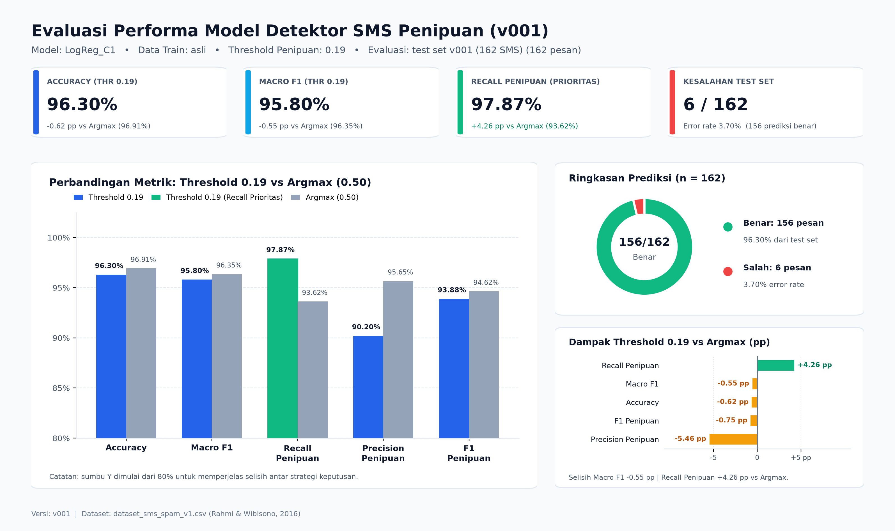
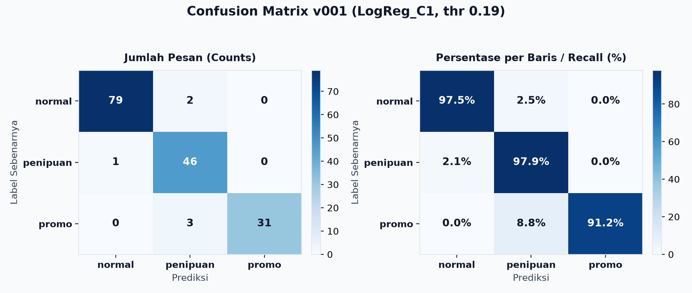
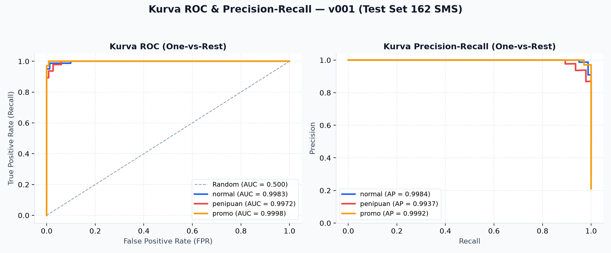
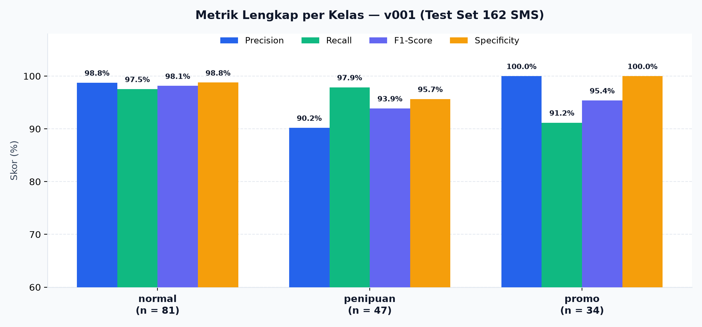
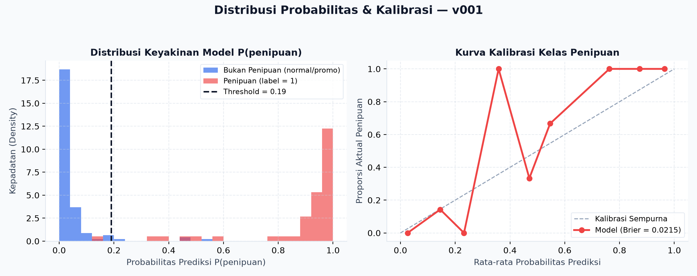

---

## 3. Detail v002 (`dataset_sms_spam_v1.csv` + `SpamDam_twitter_data.csv`, `n = 4.892`)

### Metrik per Kelas (v002 — Test Gabungan)
| Kelas | Support | TP | FP | FN | Precision | Recall | F1-Score | Specificity | ROC-AUC | PR-AUC (AP) |
|---|---:|---:|---:|---:|---:|---:|---:|---:|---:|---:|
| **normal** | 81 | 76 | 6 | 5 | 92.68% | 93.83% | 93.25% | 99.88% | 0.9935 | 0.9731 |
| **penipuan** | 4,776 | 4,755 | 17 | 21 | 99.64% | 99.56% | 99.60% | 85.34% | 0.9923 | 0.9998 |
| **promo** | 35 | 22 | 16 | 13 | 57.89% | 62.86% | 60.27% | 99.67% | 0.9928 | 0.6990 |

### Confusion Matrix (v002 — Test Gabungan)
| Aktual \ Prediksi | normal | penipuan | promo | Recall (%) |
|---|---:|---:|---:|---:|
| **normal** | 76 | 5 | 0 | 93.83% |
| **penipuan** | 5 | 4,755 | 16 | 99.56% |
| **promo** | 1 | 12 | 22 | 62.86% |

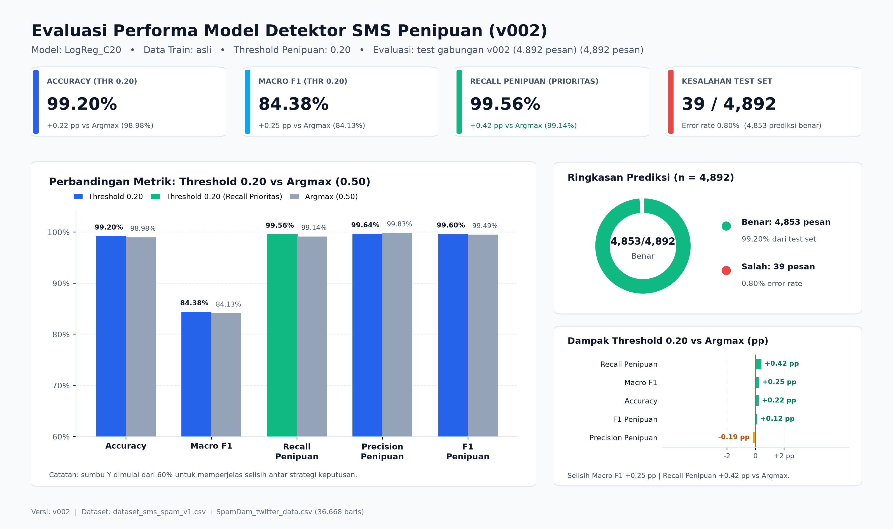
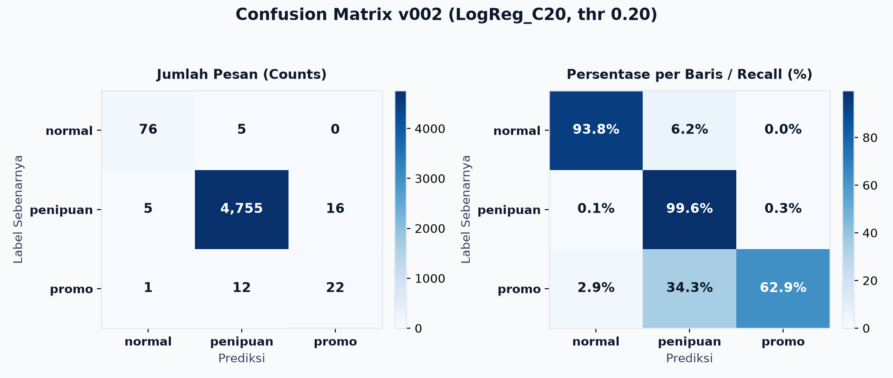
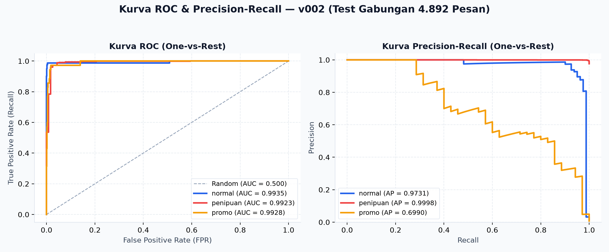
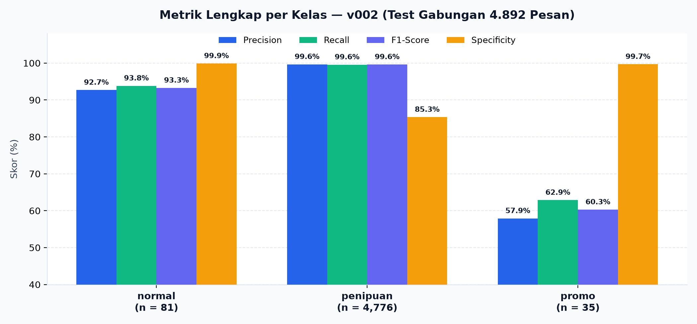
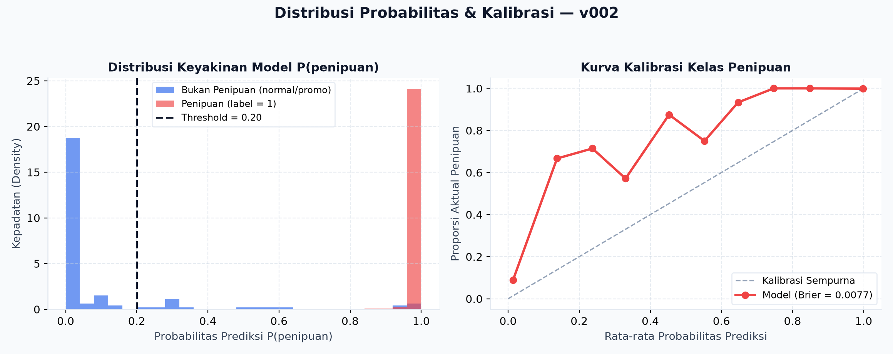

### Benchmark v002 pada Test Set v001 (`n = 162`, Bebas Leakage)
| Kelas | Support | TP | FP | FN | Precision | Recall | F1-Score | Specificity | ROC-AUC | PR-AUC (AP) |
|---|---:|---:|---:|---:|---:|---:|---:|---:|---:|---:|
| **normal** | 81 | 76 | 0 | 5 | 100.00% | 93.83% | 96.82% | 100.00% | 0.9928 | 0.9955 |
| **penipuan** | 47 | 47 | 17 | 0 | 73.44% | 100.00% | 84.68% | 85.22% | 0.9917 | 0.9754 |
| **promo** | 34 | 22 | 0 | 12 | 100.00% | 64.71% | 78.57% | 100.00% | 0.9913 | 0.9818 |

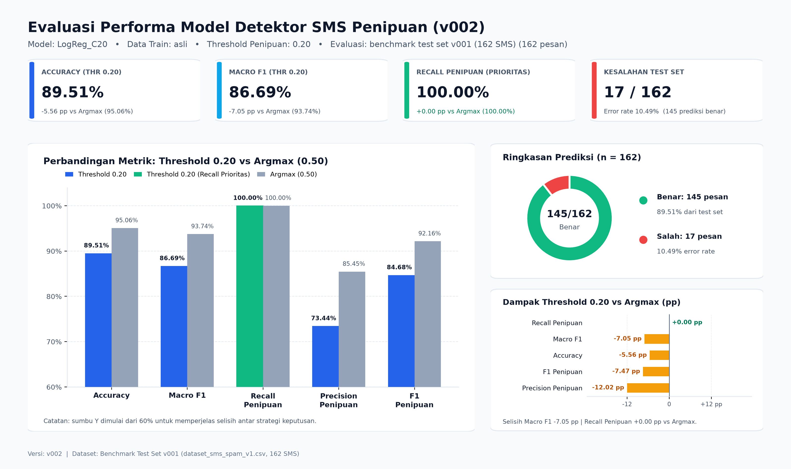
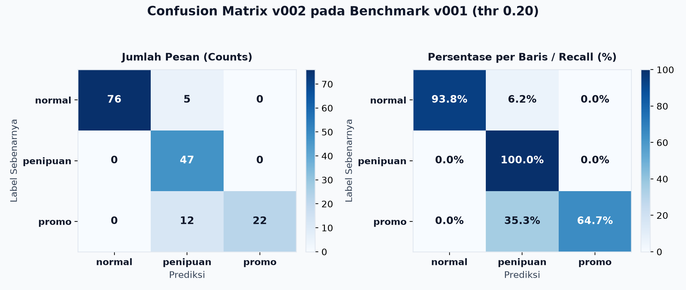
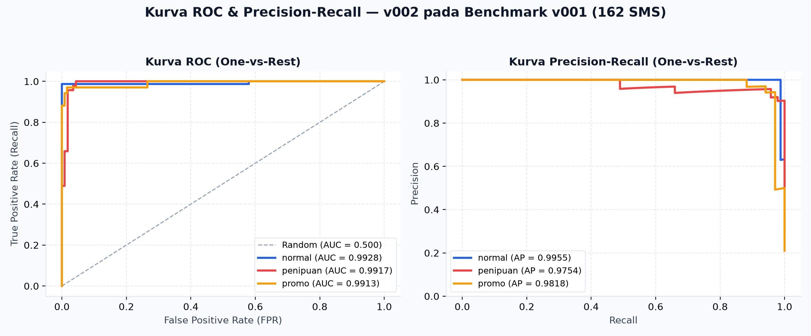

---

## 4. Daftar Isi Folder `metrics/`

- `all_metrics_complete.json` — Master JSON berisi seluruh metrik lengkap v001, v002 (test gabungan), dan v002 (benchmark v001).
- `summary_table.csv` — Tabel ringkas lintas versi & strategi (threshold & argmax).
- `per_class_metrics.csv` — Precision, Recall, F1, F2, Specificity, FPR, FNR, ROC-AUC, PR-AUC untuk tiap kelas (`normal`, `penipuan`, `promo`).
- `comparison_v001_vs_v002.csv` — Tabel selisih (delta) langsung v001 vs v002 pada benchmark 162 SMS Indonesia.
- `v001/` — JSON, CSV, analisis error, dan 6 grafik PNG untuk v001.
- `v002/` — JSON, CSV, analisis error, folder `benchmark_v001/`, dan 9 grafik PNG untuk v002.
- `comparison/` — JSON & 2 grafik PNG perbandingan langsung lintas versi.
